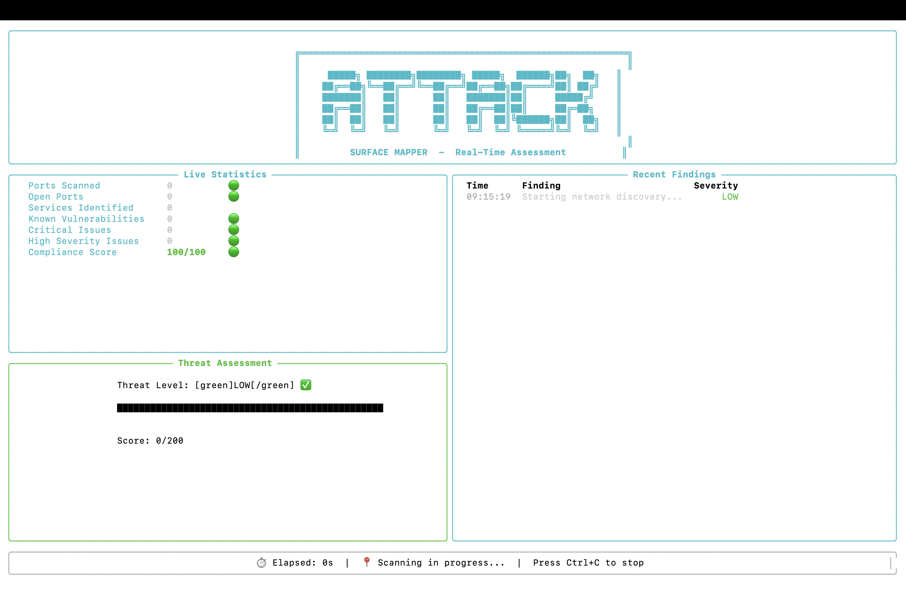
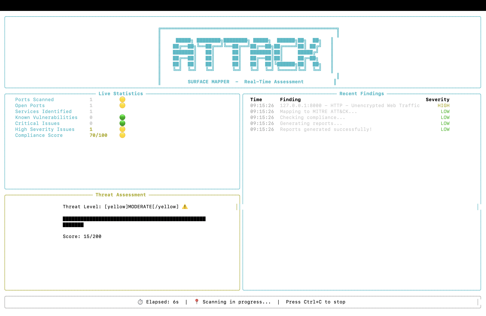
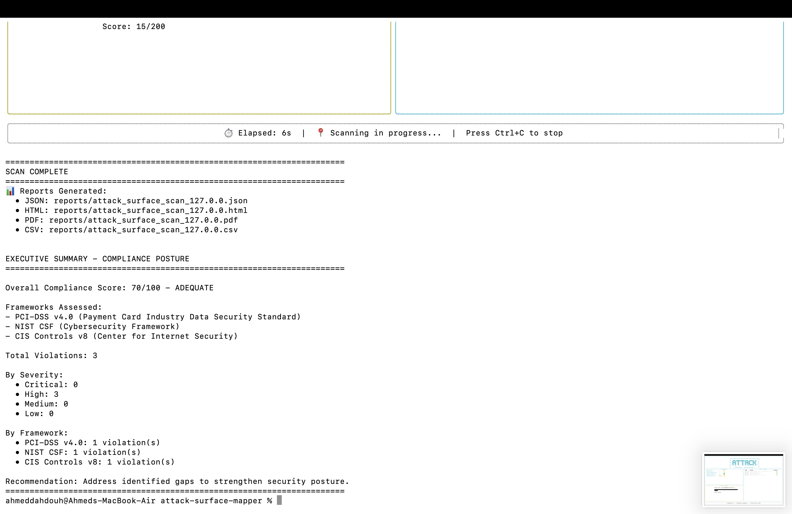
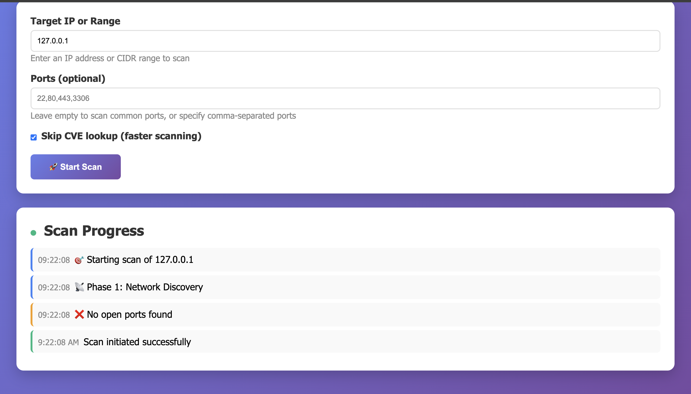
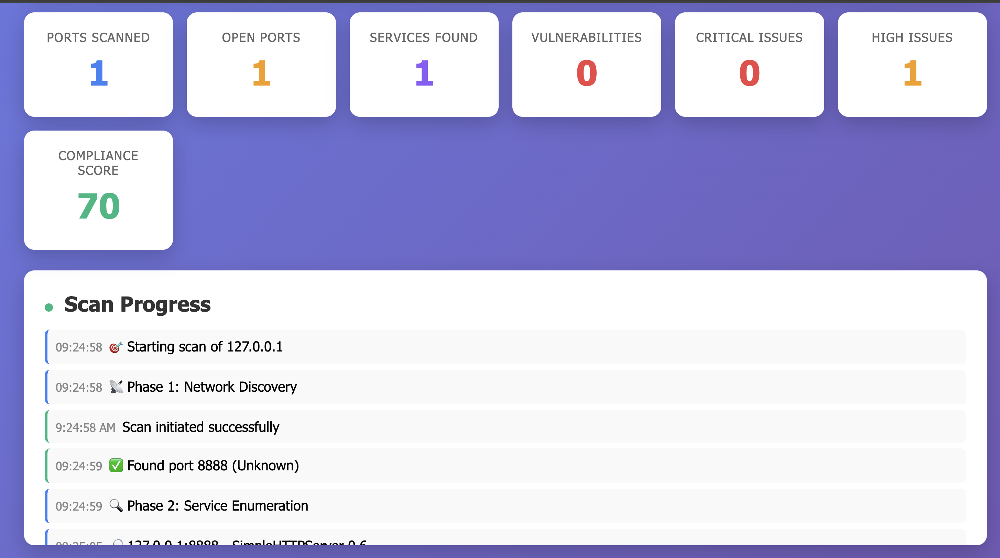
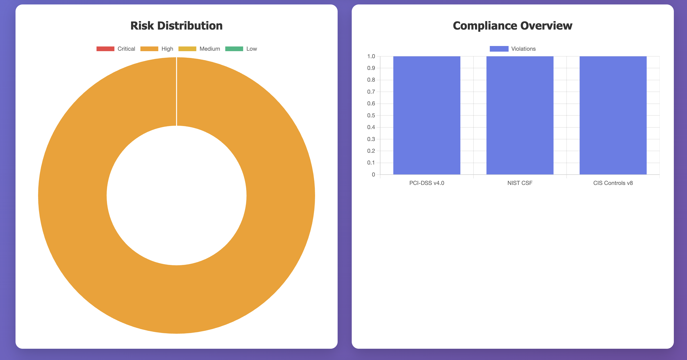

# Attack Surface Mapper

[](https://github.com/AhmedDAH1/attack-surface-mapper/tree/main/tests)


A Python-based security assessment tool that discovers network vulnerabilities, maps them to MITRE ATT&CK techniques, checks compliance against major frameworks, and provides real-time dashboards.

Built to automate security assessments while providing actionable insights through multiple interfaces — CLI, terminal dashboard, and web UI.

> **An early learning project.** It wraps Nmap rather than building scanning
> itself. Its successor, [NetScan](https://github.com/AhmedDAH1/network-scanner),
> crafts its own packets, matches CVEs by product version and comes with
> detection rules tested against its own traffic.

---

## Why I Built This

I wanted to understand what a security assessment involves end to end, beyond
running a port scan: turning open ports and service versions into findings,
mapping those findings to MITRE ATT&CK, checking them against compliance
frameworks (PCI-DSS, NIST CSF, CIS Controls), noticing when the attack surface
changes, and presenting all of it in a way someone could act on. Building the
pipeline myself, on my own lab machines, was how I learned those steps.

---

## What It Does

**Scanning**
- Finds open ports and running services (multi-threaded, 100 concurrent threads)
- Identifies exact software versions
- Grabs service banners for fingerprinting
- Detects insecure configurations (default credentials, weak SSL/TLS, cleartext protocols)

**Analysis**
- Correlates findings with CVE database for known vulnerabilities
- Maps everything to MITRE ATT&CK tactics and techniques
- Checks compliance against PCI-DSS, NIST CSF, and CIS Controls
- Calculates risk scores based on severity and exploitability

**Threat Intelligence**
- Checks if your services are exposed on Shodan (public internet exposure)
- Validates IPs against VirusTotal for malicious activity
- Identifies services visible globally vs locally

**Monitoring**
- Watches your attack surface continuously
- Detects new ports, services, or vulnerabilities as they appear
- Sends Slack alerts when critical changes happen
- Tracks trends over time with diff reports

**Reporting**
- JSON for automation and APIs
- Interactive HTML dashboards
- PDF reports
- CSV exports for spreadsheet analysis

**Visualization**
- Live terminal dashboard with real-time updates
- Web-based UI with charts, graphs, and live scanning

---

## Quick Start

```bash
# Clone the repo
git clone https://github.com/AhmedDAH1/attack-surface-mapper.git
cd attack-surface-mapper

# Install dependencies
pip install -r requirements.txt
brew install nmap  # macOS
# or: sudo apt-get install nmap  # Linux

# Run a basic scan
python main.py scan 192.168.1.100

# Use the live dashboard
python main.py scan 192.168.1.100 --dashboard

# Start the web interface
python3 web/app.py
# Then open: http://localhost:5001
```

---

## Usage Examples

**Command-Line Scanning**
```bash
# Basic scan
python main.py scan 192.168.1.100

# Scan with all features
python main.py scan 192.168.1.100 \
  --dashboard \
  --shodan-key YOUR_KEY \
  --vt-key YOUR_KEY \
  --slack-webhook https://hooks.slack.com/... \
  -o lab_assessment

# Output: 4 reports automatically generated
# - lab_assessment.json (for automation)
# - lab_assessment.html (interactive dashboard)
# - lab_assessment.pdf (report)
# - lab_assessment.csv (for spreadsheets)
```

**Live Terminal Dashboard**
```bash
# Real-time terminal dashboard
python main.py scan 192.168.1.100 --dashboard
```

Shows live statistics, threat-level meter, recent findings stream, and elapsed-time tracker.

**Web Interface**
```bash
python3 web/app.py
# Open browser to http://localhost:5001
```

Point-and-click scanning, real-time progress updates, interactive charts, and one-click report downloads.

**Continuous Monitoring**
```bash
# Monitor your infrastructure every hour
python main.py monitor 192.168.1.0/24 \
  --interval 60 \
  --slack-webhook https://hooks.slack.com/...
```

Sends Slack alerts when new ports open, services change versions, new vulnerabilities appear, or critical misconfigurations are detected.

---

## Screenshots

### CLI Terminal Dashboard

*Live terminal dashboard — real-time statistics and threat assessment*


*Scan complete — findings detected with MODERATE threat level*

### Scan Output

*Executive compliance summary printed after every scan*

### Web Interface

*Web dashboard — point-and-click scanning with live updates*


*Real-time scan progress — phases, findings, and MITRE mapping live*

### Analytics

*Risk distribution and compliance overview charts*

### Report Downloads

*One-click download for JSON, HTML, PDF, and CSV reports*

---

## Interfaces

**Command-Line Interface** — traditional CLI, perfect for scripting and automation. All features available via flags. Generates all 4 report formats.

**Live Terminal Dashboard** — real-time statistics with threat-level visualization and activity stream. Built with the Rich library.

**Web Dashboard** — real-time WebSocket updates, interactive charts, downloadable reports. Mobile-responsive.

---

## API Keys (All Free Tier, All Optional)

**Shodan** — checks global exposure
- Sign up: https://account.shodan.io/register
- Free tier: 100 queries/month
- Use: `--shodan-key YOUR_KEY`

**VirusTotal** — checks IP reputation
- Sign up: https://www.virustotal.com/gui/join-us
- Free tier: 500 requests/day
- Use: `--vt-key YOUR_KEY`

**Slack** — for alerts
- Create webhook: https://api.slack.com/messaging/webhooks
- Use: `--slack-webhook https://hooks.slack.com/...`

The tool works without any of these. They add external intelligence when configured.

---

## Command Reference

```bash
# CLI Scanning
python main.py scan <target>                    # Basic scan
python main.py scan <target> --dashboard        # With live UI
python main.py scan <target> -p 22,80,443       # Specific ports
python main.py scan <target> --skip-cve         # Skip CVE lookup (faster)
python main.py scan <target> -o my_scan         # Custom output name

# Full scan with all integrations
python main.py scan <target> \
  --dashboard \
  --shodan-key KEY \
  --vt-key KEY \
  --slack-webhook URL \
  -o full_assessment

# Continuous monitoring
python main.py monitor <target> -i 60           # Every 60 minutes
python main.py monitor <target> -i 30 -n 5      # 5 scans then stop

# Web Interface
python3 web/app.py                              # Start web server
# Then open: http://localhost:5001
```

---

## Project Structure

```
attack-surface-mapper/
├── src/
│   ├── scanners/           # Port scanning, enumeration, config auditing
│   ├── analyzers/          # MITRE mapping, compliance checking
│   ├── reporters/          # JSON, HTML, PDF, CSV generation
│   ├── integrations/       # Shodan, VirusTotal, Slack
│   └── core/               # Continuous monitoring, live dashboard
├── web/
│   ├── app.py              # Flask web server
│   ├── templates/          # HTML templates
│   └── static/             # CSS, JavaScript
├── data/                   # MITRE ATT&CK data, CVE cache, scan history
├── reports/                # Generated reports (gitignored)
├── tests/                  # Unit tests (23 passing)
└── main.py                 # CLI entry point
```

---

## Technical Details

**What makes it fast**
- Multi-threaded port scanning (100 concurrent threads)
- CVE result caching (won't hit NVD repeatedly)
- Smart rate limiting for external APIs

**Security considerations**
- Skips private IPs for Shodan/VT checks automatically
- Never actually tests credentials (flags risk only)
- Rate-limited to respect API quotas
- Stores API keys in environment/args, never in code

**What it doesn't do**
- Exploit vulnerabilities (this is a mapper, not a pentesting framework)
- Perform active attacks or fuzzing
- Modify target systems
- Store credentials or sensitive data

---

## Compliance Frameworks Supported

**PCI-DSS v4.0** — Payment Card Industry
- Requirement 2.1: Change vendor defaults
- Requirement 2.2: Disable unnecessary services
- Requirement 4.1: Use strong cryptography
- Requirement 4.2: Never send PANs by unencrypted means

**NIST Cybersecurity Framework**
- PR.DS-2: Data in transit protection
- DE.CM-8: Vulnerability scanning
- PR.AC-4: Access control management

**CIS Controls v8**
- Control 1.1: Asset inventory
- Control 4.1: Secure configuration
- Control 7.1: Vulnerability management

---

## Known Limitations

- Requires `nmap` installed on the system
- Free API tiers limit how many IPs you can check
- Can't scan through firewalls
- Python 3.9+ required
- macOS and Linux only (Windows untested)
- Web UI runs on development server (use gunicorn for production)

---

## Contributing

Found a bug? Have an idea? Open an issue or PR.

This is a portfolio project but I'm always interested in making it better.

---

## Legal

**For authorized security testing only.**

Don't scan networks you don't own or have explicit written permission to test. Unauthorized port scanning may be illegal in your jurisdiction (CFAA in the US, Computer Misuse Act in the UK, Article 303a StGB in Germany, etc.).

---

## License

MIT — see [LICENSE](LICENSE)

---

## Author

**Ahmed Dahdouh** — Software Engineering Student · Cybersecurity Enthusiast

Built as a portfolio project demonstrating:
- Multi-threaded scanning and analysis
- Real-time data streaming via WebSockets
- 3 user interfaces (CLI, terminal dashboard, web UI)
- 4 report formats (JSON, HTML, PDF, CSV)
- Integration with Shodan, VirusTotal, and the NVD CVE database
- MITRE ATT&CK technique mapping
- Compliance assessment against PCI-DSS, NIST CSF, and CIS Controls

[](https://github.com/AhmedDAH1)
[](https://www.linkedin.com/in/ahmed-dahdouh)
